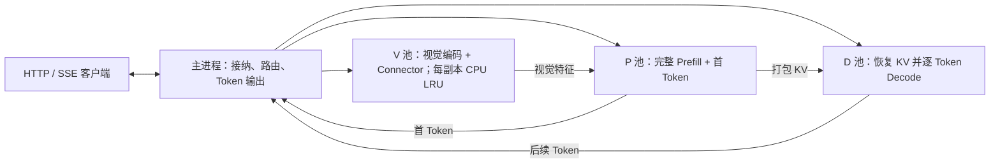

# xixi-server

**将 SmolVLM 的视觉编码、Prefill、Decode 拆成独立进程的单机推理服务。**

基于 [Azure/ModServe](https://github.com/Azure/ModServe) 扩展，新增 PyTorch / Transformers 后端。
本项目集中实现阶段设备池、视觉特征与 KV Cache 交接、有界并发路由、HTTP/SSE 和 CPU 视觉特征 LRU，
并提供单体模型对照、正确性验收和可复现基准。已完成真实 **4×RTX 4090、1V+1P+2D** 验收。

## 实现与设计



- **阶段设备池与调度：**每个配置设备对应一个 worker；从各池空闲副本轮询选择，原子预留整条路由。V/P 在交接 ACK 后释放，D 在生成结束后释放；1V+1P+2D 可让两个请求的 Decode 重叠。
- **通信与所有权：**Gloo 传元数据和 ACK，张量可选 CPU/Gloo 或 CUDA/NCCL；P 打包多层 KV，D 恢复 `DynamicCache`。接收端核对请求、形状和预算并确认接管后，发送端才释放数据。
- **背压与流式归属：**默认最多接纳 4 个请求，超额返回 429；资源不足在主进程 FIFO 等待。唯一事件泵按请求 ID/rank 分发，各 SSE 流独立重排 Token。活动交接异常时整组回收。
- **视觉特征复用：**每个 V 有独立的内容寻址、字节级 CPU LRU。缓存按请求图数隔离，部分命中时补齐原 encoder batch，解决 BF16 batch 形状变化导致的输出漂移，并单独记录补齐计算成本。

实现细节和设计取舍见 [架构](docs/architecture.md)，源码入口见 [目录说明](docs/project_structure.md)。

## 实测结果

固定拓扑 B、相同 4×RTX 4090 / 1V+1P+2D，SmolVLM-256M BF16、每请求双图、greedy 生成 8 Token；
每模式每场景 3 轮×20 请求，性能组关闭完整载荷 SHA256。以下均为合成负载结果。

| 对照条件 | 结果 | 含义 |
|---|---|---|
| NCCL 冷图、关闭缓存，客户端并发 1→2 | 23.9→44.9 输出 Token/s（+87.5%） | 同一四卡布局的并发容量变化 |
| 同负载，并发 2→4 | 44.9→46.4 Token/s；路由等待 P50 达 332.2ms | 两个 D 限制活动路由数，继续加并发收益有限 |
| NCCL 并发 1、混合复用、90% 图片命中，关闭→开启缓存 | TTFT P50 144.2→126.4ms（降低 12.3%） | 同条件冷图 TTFT 约增加 0.7% |

修复版本累计 **3420 条测量请求**，其中 **2280 条 VPD 请求逐 Token 对齐单体模型**；HTTP 失败与 Token 不一致均为 0。
完整负载、逐轮结果、硬件身份和测试范围见 [四卡报告](docs/validation/four-gpu-20261101.md) 与 [机器可读摘要](docs/validation/four-gpu-20261101.json)。

这些比较不代表单卡到四卡的等预算扩容收益。四卡 CUDA peer access 均为 false，NCCL 实际使用 SHM；
CPU 缓存和完整载荷校验也会产生搬运，不能称为直接 GPU P2P、NVLink 或全程零拷贝。

## 快速开始

目标环境为 Linux/WSL、Python 3.10。项目名称和发行包名为 `xixi-server`，Python 导入名保留 `lmm_serving`。
在独立环境中安装主线依赖，无需构建上游 vLLM，也无需 `pip install -e .`：

```bash
git clone https://github.com/xixii421/xixi-server.git
cd xixi-server
python3.10 -m venv .venv-vpd
.venv-vpd/bin/python -m pip install -r requirements-vpd-cuda.txt
```

准备本地 [SmolVLM-256M-Instruct](https://huggingface.co/HuggingFaceTB/SmolVLM-256M-Instruct) 权重、模型配置及 processor/tokenizer 文件。
以下命令均从仓库根目录运行，将 `/path/to/SmolVLM-256M-Instruct` 替换为实际模型目录。

单卡启动三个进程，以 CPU/Gloo 中转张量：

```bash
PYTHONPATH=src .venv-vpd/bin/python -m lmm_serving.launcher vpd \
  --model /path/to/SmolVLM-256M-Instruct \
  --device cuda:0 --transport gloo --port 8099
```

四卡配置 1V+1P+2D：

```bash
PYTHONPATH=src .venv-vpd/bin/python -m lmm_serving.launcher vpd \
  --model /path/to/SmolVLM-256M-Instruct --transport nccl \
  --vision-devices cuda:0 --prefill-devices cuda:1 --decode-devices cuda:2 cuda:3 \
  --max-inflight 4 --port 8099
```

设备编号按 `CUDA_VISIBLE_DEVICES` 映射后的逻辑编号解释；NCCL 每个 worker 独占一张可见 GPU。
容器需有足够共享内存：本轮 10GiB `/dev/shm` 通过，64MiB 时初始化失败。
复现实验应核对 GPU UUID/PCI、NUMA 拓扑和依赖，见 [多卡部署与验收](docs/vpd_multigpu.md)。

没有 GPU 或权重时，可用随机微型 Idefics3 验证真实模型计算和进程协议；随机权重不具备可用的问答能力：

```bash
python3.10 -m venv .venv-cpu
.venv-cpu/bin/python -m pip install -r requirements-pd-local.txt
PYTHONPATH=src .venv-cpu/bin/python -m lmm_serving.vpd_service \
  --device cpu --dtype float32 --port 8099
```

## HTTP / SSE

`GET /health` 查看 worker 状态，`POST /v1/chat/completions` 支持文本、内联 PNG/JPEG、多图与 SSE。
`model` 应与启动日志一致，真实模型示例为 `SmolVLM-256M-Instruct`；随机微型模型为 `tiny-idefics3`。

```bash
curl -N http://127.0.0.1:8099/v1/chat/completions \
  -H 'Content-Type: application/json' \
  -d '{"model":"SmolVLM-256M-Instruct","messages":[{"role":"user","content":"Explain KV cache briefly."}],"max_tokens":8,"stream":true}'
```

| 选项 | 用途 |
|---|---|
| `--vision-cache-mib 16` | 每个 V 的 CPU 特征 LRU 预算；`0` 关闭 |
| `--transport gloo` / `nccl` | CPU/Gloo 或 CUDA/NCCL 张量交接 |
| `--stage-devices V P D` | 三 worker 的设备映射，与设备池参数互斥 |
| `--vision-devices … --prefill-devices … --decode-devices …` | 三个非空阶段设备池 |
| `--max-inflight 4` | 排队、执行、尚未返回的消费者总上限 |
| `--no-handoff-checksum` | 关闭完整载荷 SHA256；保留元数据、预算与 ACK 检查 |

当前固定长度 greedy、`n=1`、最多 32 个输出 Token、每请求最多两张图。图片请求和接口限制见 [使用说明](docs/vpd_local.md)。

## 验证与复现

使用已安装主线依赖的环境运行，不下载模型；真实多卡用例在硬件不足时跳过，报告分别记录执行和跳过数：

```bash
PYTHONPATH=src .venv-vpd/bin/python utils/run_regressions.py \
  --suites vpd_router vpd_parallel vpd_transport vpd vpd_pools vpd_tools vision_cache pd_local pd_service stream_benchmark launcher \
  --timeout 180 --output-dir metrics/local-check-001
```

真实四卡的一键验收，包含拓扑、全候选边传输探针、单体输出对齐和 HTTP/SSE；加 `--benchmark --concurrency 2` 执行正式负载：

```bash
PYTHONPATH=src .venv-vpd/bin/python utils/validate_vpd_multigpu.py \
  --model /path/to/SmolVLM-256M-Instruct \
  --vision-devices cuda:0 --prefill-devices cuda:1 --decode-devices cuda:2 cuda:3 \
  --output-dir metrics/four-gpu-check-001
```

每次使用新输出目录，保留原始日志。仓库提供 [公开验证摘要](docs/validation/README.md)，原始 JSONL、模型和运行环境保留在实验机，未随仓库分发。
仓库配置了 [CPU 回归工作流](.github/workflows/cpu-regression.yml)，在 push/PR 时执行上述套件并保存日志；它不包含真实 GPU 验收。

## 范围与来源

这是单机、worker 内顺序执行的推理服务原型；当前没有连续批处理、同 worker 计算通信重叠、TP、多机、鉴权或在线故障恢复。
P/D 各持一份语言权重；不等同于模型张量并行。当前支持 Idefics3/SmolVLM 的视觉特征插入路径。

上游 ModServe 的模型适配、vLLM 补丁和历史代码继续保留；新增后端与上游论文的贡献及验证范围分别说明。
详见 [文档导航](docs/README.md)、[上游来源与部署](docs/upstream/README.md)、[MIT 许可证](LICENSE)。
