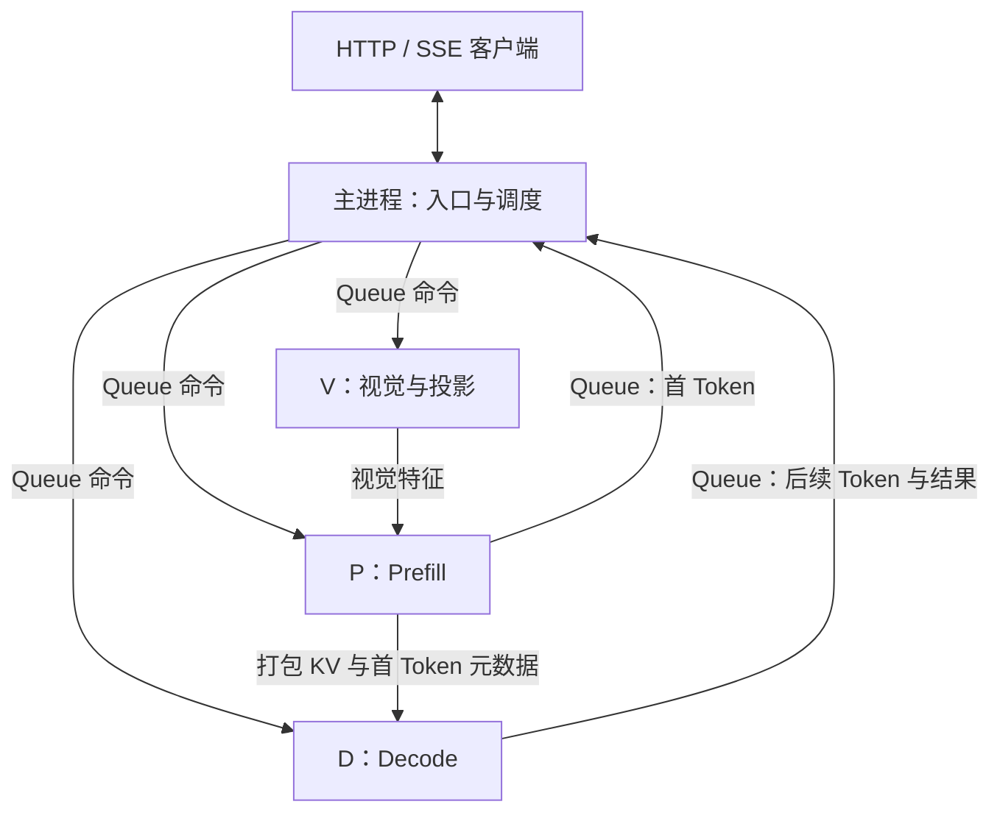

# V/P/D 三阶段服务架构

## 目标与范围

把一个真实多模态生成请求拆为视觉编码 V、语言 Prefill P、语言 Decode D，明确每个阶段持有什么权重、传什么数据、何时可以释放数据。当前实现面向单机 Idefics3/SmolVLM 的视觉特征插入模型，支持单图、多图、纯文本和 HTTP/SSE。

设计采用一条串行请求通道。先保证模型输出一致、交接边界明确，并提供 Gloo/NCCL 对照实验；多请求流水线、动态批处理、TP/DP、多机与在线故障恢复均不在当前实现中。

多卡设备池和 NCCL 路径已实现。现有硬件只有一张 RTX 4060 Laptop，真实多卡 P2P 和性能结果需在目标服务器补充。

## 组件与数据所有权

| 组件 | 职责 | 持有的数据 |
|---|---|---|
| HTTP 主进程 | 接纳请求、调度 worker、按序输出 Token | 请求描述、队列、Token 事件；不接收特征/KV 载荷 |
| V 池 | 预处理、视觉 Transformer、Connector、特征复用 | 每副本视觉权重、CPU LRU、本次特征 |
| P 池 | 将视觉特征插入语言序列，完整 Prefill | 每副本语言权重、prompt KV、首个生成 Token |
| D 池 | 恢复 KV，每步输入一个 Token 续算 | 每副本独立语言权重、本请求逐步增长的 KV |
| `TensorChannel` | 准备/收发张量，完成同步和可选校验 | 交接期间的通信缓冲区 |

P/D 分别加载语言模型，属于阶段分离，未将同一模型的层或矩阵切到多张卡。每个 worker 先在 CPU 加载完整模型，再裁剪阶段模块并上传设备，因此启动时仍需考虑完整模型的 CPU 内存。



rank 是进程在通信组中的编号，不是 GPU 编号。三卡模式默认 V/P/D 对应 `cuda:0/1/2`，允许重新映射。`CUDA_VISIBLE_DEVICES` 生效后，参数按可见设备的逻辑编号解释。

### 阶段与设备池解耦

`stage_pools=(V设备列表, P设备列表, D设备列表)` 决定进程布局。按 V/P/D 的顺序展开后，
每个设备分配一个 global rank；`worker_stages` 记录 rank 所属阶段。
例如 `V=[0], P=[1], D=[2,3]` 启动四个进程，rank 2/3 都执行 Decode；
`V=[0,1], P=[2], D=[3]` 中 Prefill 是 rank 2，不再按 rank 1 写死。

主进程在请求锁内为各阶段独立轮询，生成固定的 `route={vision,prefill,decode}`。
纯文本不选择 V，也不推进 V 的轮询计数。该路由随请求下发并写入交接头；
所有源、目标和 ACK 均使用本次路由，接收方也核对路由归属。
所有副本一起初始化通信组并预热，未选中的副本等待命令，仍参与健康监督和整组回收。

这是一条串行通道上的副本路由，不是并行流水线。增加副本目前用于验证不同资源配置与
连接正确性，不构成扩容收益。探针遍历 V×P、P×D 全部候选边，避免独立轮询只覆盖对角组合。

## 输入准备与执行边界

`prepare_request` 在入口完成消息、内联图片和生成长度检查，产生 `PreparedVPDRequest`，保存规范化 messages、已解码图片 bytes 和 new_tokens。HTTP 先准备输入再打开 SSE；运行时的 `run_prepared` 直接执行这份请求，避免同一张图片在 HTTP 和运行时重复 Base64 解码、PIL 验证。

`LocalVPD` 与单体对照 `MonolithicVLM` 使用相同的准备入口。程序直接调用时仍可用 `run(messages, new_tokens)`，它组合准备与执行。实际 token 数需在 processor 展开图像占位符后检查，不能用一个虚构 token 代替完整 prompt 验证。

模型配置和在线签名按实例缓存为启动快照，不在每次请求中反复读 JSON 或计算配置摘要。
权重和配置在运行期间保持不变；模型构造器收到配置副本，避免补写字段污染快照。

## 三类通信

| 通信 | 机制 | 承载内容 |
|---|---|---|
| 主进程 ↔ worker | `multiprocessing.Queue` | 请求命令、准备完成、Token、阶段完成、错误 |
| worker ↔ worker 控制 | 默认 Gloo 进程组 | 有界 JSON 头、ACK |
| worker ↔ worker 数据 | Gloo 或单独的 NCCL 组 | 视觉特征和打包 KV 张量 |

主进程不加入 worker 通信组。各 worker 设置当前设备，创建默认 Gloo 组；NCCL 模式再由所有 rank 按相同顺序创建数据组并共同预热。文件式 rendezvous 只用于本机启动发现，不承载模型数据。

Gloo 模式的载荷位于 CPU，接收后再放到本阶段计算设备；NCCL 模式的载荷直接位于对应 GPU。元数据头以“字节长度 + JSON 字节”发送，张量尺寸由本地模型与请求推导。

## 一次请求的时序

### 含图请求

1. 入口准备消息和图片，检查输入与生成长度。运行时取得请求锁，分配请求 ID 和串行序号。
2. 主进程只向 V 下发请求。V 用 processor 得到展开图像占位符后的完整 token 序列，检查 prompt 与 KV 预算，编码或复用视觉特征。
3. V 先通过事件队列发送 `vision_ready`。主进程据此把相同 token 序列和有序图像上下文下发给 P/D。
4. V 向 P 发元数据和特征；P 核对身份/形状、接收并准备好特征，再回 ACK。V 释放本次交接引用。
5. P 完整执行 Prefill，向主进程报告首 Token；随后把 prompt KV 打包发送给 D。D 恢复缓存并回 ACK，P 才释放本次 KV。
6. D 用首 Token 和收到的 prompt KV 续算后续 Token，经事件队列报告结果。主进程收齐阶段完成消息后结束请求、释放请求锁。

第 3 步必须发生在 V 等待 P 接收之前：P 需要先获得请求命令和展开后的 tokens，才能验证并接收特征。否则会形成“主进程等 V、V 等 P、P 等主进程”的等待环。

### 纯文本请求

主进程生成文本 tokens，直接调度 P/D，V 不参与本次请求的数据交接。P/D 的 KV 协议与含图路径相同。

### Token 顺序

P 产生 Token 0，D 产生 Token 1 及后续 Token。不同 worker 的队列 feeder 到达顺序可能不同，主进程按 Token index 缓存，只对客户端输出连续前缀。请求结束时，流式 Token 序列应与完整结果一致。

首 Token 在 KV 交接前即可报告，故 KV 优化不一定体现在 TTFT 上。实验还需关注首/第二 Token 间隔、后续 TBT 和 E2E。

## 张量协议与生命周期

视觉特征布局为：

```text
[图片数, 每图视觉 Token 数, 语言隐藏维度]
```

每层 K 或 V 的布局为：

```text
[batch=1, KV 头数, prompt 长度, 每头维度]
```

多层缓存按 `K0, V0, K1, V1, ...` 展平后拼成一个连续缓冲区。D 按相同顺序创建视图，再用 `DynamicCache` 恢复逐层 K/V。这里使用 `num_key_value_heads`，以适配 KV 头数少于 Query 头数的 GQA。

头部绑定请求 ID、序号、模型签名、prompt 摘要、有序图片上下文、dtype 和可选载荷摘要；本地配置决定接收形状与字节预算。检查主要集中在输入入口与交接边界，阶段内按已经成立的约定执行。

一个交接的所有权规则是：

```text
发送端持有源数据和通信缓冲区
    → 发送头部与载荷
    → 接收端完成接收、验证、设备搬运和状态恢复
    → 接收端发 ACK
    → 发送端释放本次交接引用
```

`detach()` 只断开梯度关系，`.to()` / `.contiguous()` 在满足条件时也可能复用存储。准备通信张量不等于取得独立快照，交接中不能修改仍被引用的数据。KV 打包的 `cat` 会分配新存储，峰值占用还包括源 KV、打包缓冲区和接收侧副本。

当前在异步收发 API 后立即等待并同步设备，以建立明确的可用边界。接收张量已经位于计算设备时，后续 stage 不重复执行设备同步。ACK 表示对端已接管，区别于本地发送完成；也不表示 Decode 已结束。该实现尚未用独立 stream/event 实现计算通信重叠。

完整载荷 SHA256 默认开启，会产生 CUDA → CPU 镜像。性能实验可关闭载荷校验，身份、形状、预算和 ACK 仍保留。模型在线签名基于本地模型来源与配置，不是权重文件逐字节哈希；权重须在运行期间保持不变，验收工具另外记录文件摘要。

## CPU 视觉特征 LRU

每个 V 副本拥有独立 LRU，无跨进程共享。缓存预算按每个 V 副本计算；轮询到另一个 V 时，同图可能先分别未命中，因此预热和命中率需按实际路由统计。键由原始图片内容摘要和模型/预处理命名空间构成，特征与提问文本无关，因此同图不同问题可以复用视觉结果。

命中跳过视觉 Transformer 和 Connector，仍执行图像预处理。部分命中时只编码未命中的不同图片，再按原始图片顺序组装特征；同一请求的重复未命中图片只编码一次。

LRU 按驻留特征字节计费，存取均采用独立副本，避免请求修改缓存或一个小视图保留整批底层存储。预算不包含模型、当前请求的临时张量、预处理图片和通信缓冲区。

CPU 缓存在 NCCL 模式下仍需上传至 V 的 GPU 再发送。视觉编码只负责生成特征，最终通信设备统一由 `channel.prepare` 决定。只有关闭视觉缓存和完整载荷校验时，应用层视觉交接才不经过整张量 CPU 中转；图像预处理与控制消息仍在 CPU。

## 调度与失败处理

HTTP 层用有界槽位限制已接纳请求，运行时用一把锁覆盖完整交接。这样一条通道上始终只有一个请求，头部、载荷和 ACK 的顺序可直接推导，不需要为当前规模引入多路复用、分布式调度器或复杂状态机。

开始交接前的输入错误可以拒绝后继续服务。交接开始后的超时、worker 异常或生成回调失败会让双方位置变得不确定，运行时关闭整组进程，后续请求要求重启。关闭先尝试正常退出，再终止仍卡在通信中的进程，不尝试局部恢复或自动重试半次交接。

启动与请求使用各自的主进程截止时间。通信组超时取两者较大值，避免较短的请求预算提前中断首次初始化；请求仍受主进程请求截止时间约束，失败后统一回收。

验收探针只有在通信组销毁完毕、三个工作进程都正常退出后才算通过；发送过成功消息不能替代退出状态。报告保留每个进程的最终退出码。

## 模块边界与后续工作

| 模块 | 负责 | 不负责 |
|---|---|---|
| `vpd_service.py` / `pd_service.py` | HTTP 接口与 SSE 适配 | 模型数据传输与 GPU 调度 |
| `vpd_local.py` | 模型阶段、输入、请求编排 | 上游 vLLM 动态批处理 |
| `vpd_transport.py` | 载荷位置、收发、KV 打包与接管 | 跨请求路由或通信重叠 |
| `vision_cache.py` | 单进程 CPU LRU | KV 前缀缓存、分布式缓存 |
| `monolithic_local.py` | 相同预处理与生成策略的持久单体对照 | 多卡等资源扩容基线 |
| `utils/` | 验收与可复现实验 | 生产流量负载与付费资源管理 |

当前优先补齐目标设备池的真实多卡验收，再依据数据决定是否做通信重叠或请求流水线。更多 GPU 不保证小模型更快，独立设备映射本身也不构成吞吐扩容结论。

验收先对齐输出，再比较同样设备映射下的 Gloo/NCCL；缓存比较包含热图、冷图和混合负载。多副本与单体一卡需要分别注明 GPU 资源，不能以不等资源实验推导线性加速或成本下降。

部署与实验命令见 [README](../README.md) 和 [三卡验收说明](vpd_multigpu.md)。历史单卡结果保留在 [消融报告](vpd_benchmark.md)，当前性能数值由新的实测报告补充。
